# Katib 776 Ledger, built into the app
Direction A is now in the real views: the popover, the Manage Permissions sheet and the dictation receipt.
Images below come from the real SwiftUI views (preview test), not mockups. They sit next to the A mockups.
Nothing is released: the version is still 2.2.2 plus the unreleased 2.3.0 bump, no DMG, no notarization.

**Decided (Asif 2026-11-20 14:19, decision 486):** 40 words a minute is the default; each person can change it in Settings > Dictation.

## What changed
- **Popover**: 1,286 in large type, then Dictations, Spoken, Typing would take and Time saved (purple) with dotted leaders. Last dictation has a purple left rule and a receipt line. Copy / Paste again / Undo are underlined text. The 776 mark sits in the footer. The owl left the popover header; the Katib icon stays.
- **Manage Permissions**: "Manage permissions." with a purple stop, a PERMISSION / STATUS table, outline Grant buttons, one filled purple "Relaunch to finish" when needed. All behaviour kept: live state, Grant, drag, relaunch, single close button.
- **Receipt**: `Slack ..... 21 w  0:08  +0:23` shows in the popover under the last dictation and in the dictation window after a paste.
- **Today**: the count rolls over at local midnight. It used the UTC date, so it reset at 4 pm Pacific.
- **Type**: SF Pro, not Switzer (see below).

:::more Before and after: Manage Permissions
Before (2026-11-20 morning, green capsules and a blue callout), then after.

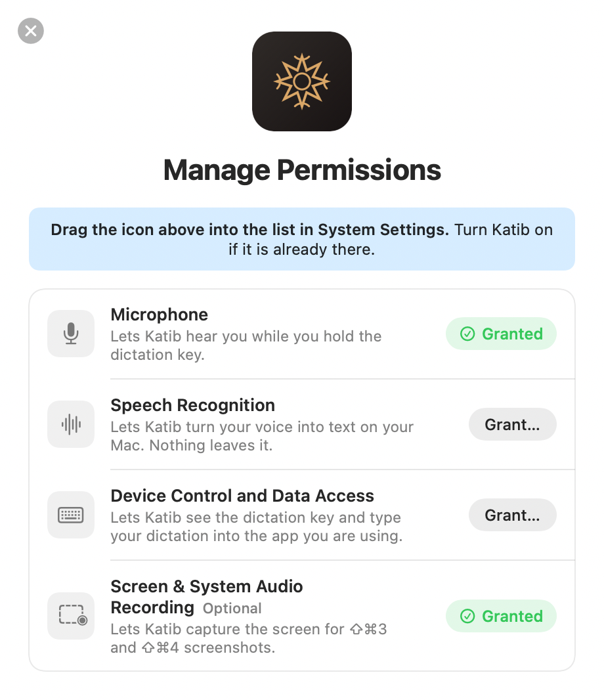
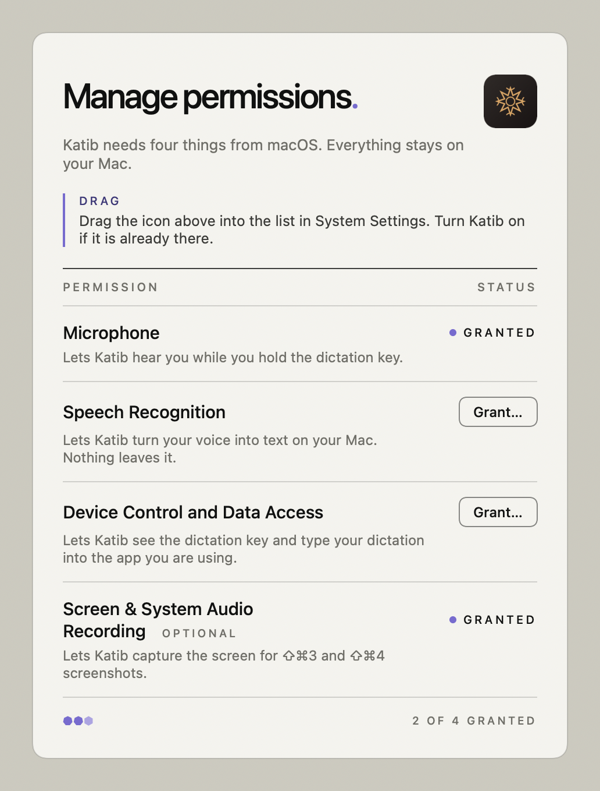
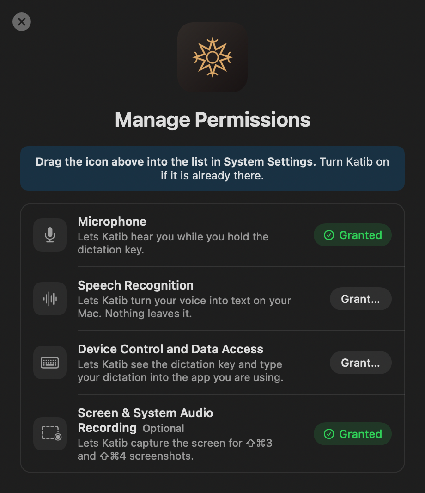
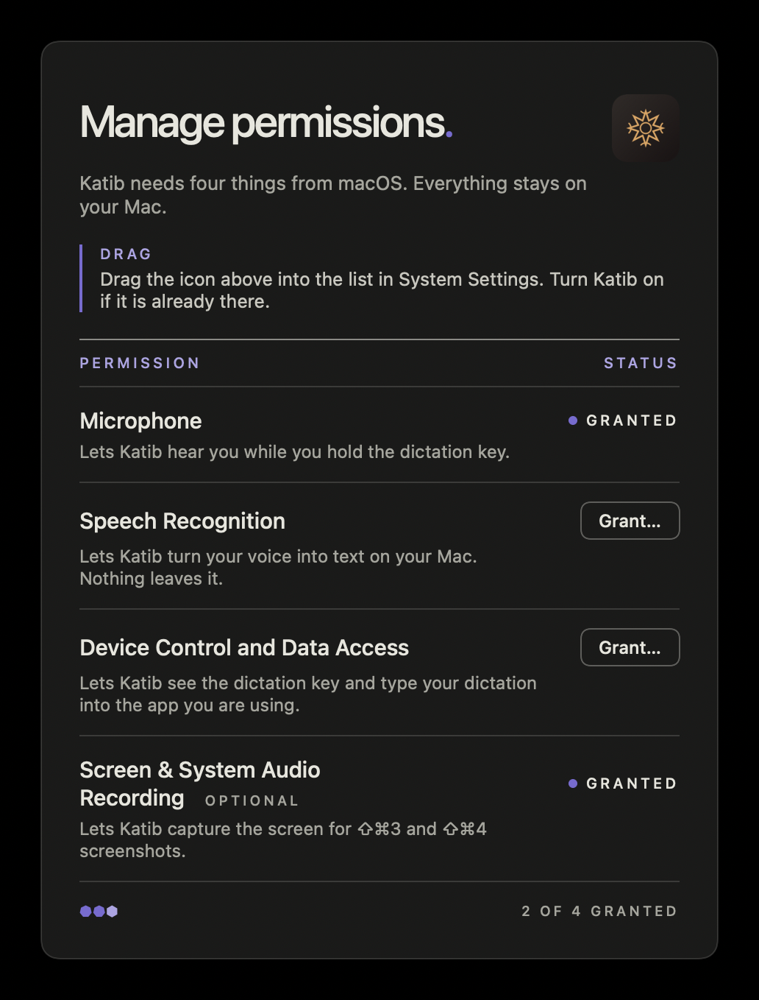

Mockup A for comparison: 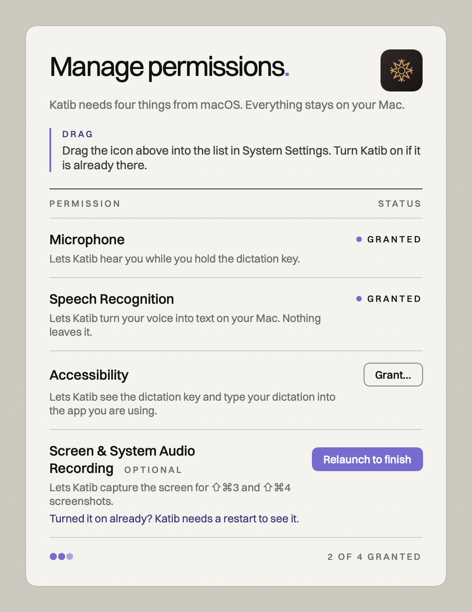
:::

:::more Popover: built next to mockup A
Built, light and dark, then mockup A. The built view uses SF Pro and the current local time (2:07 PM); the mockup used Switzer and 14:07. The popover is an NSPopover, so the live window keeps system corners.

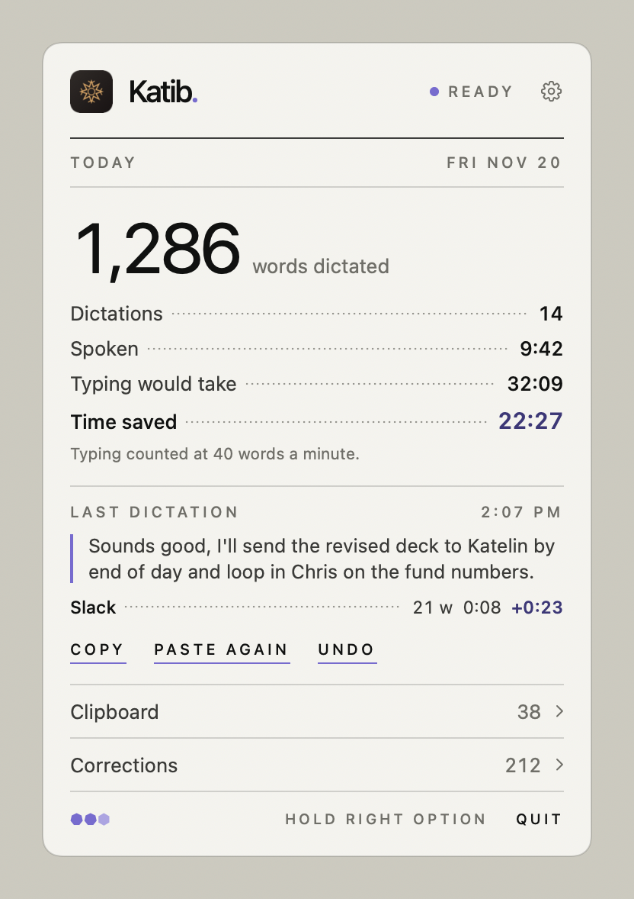
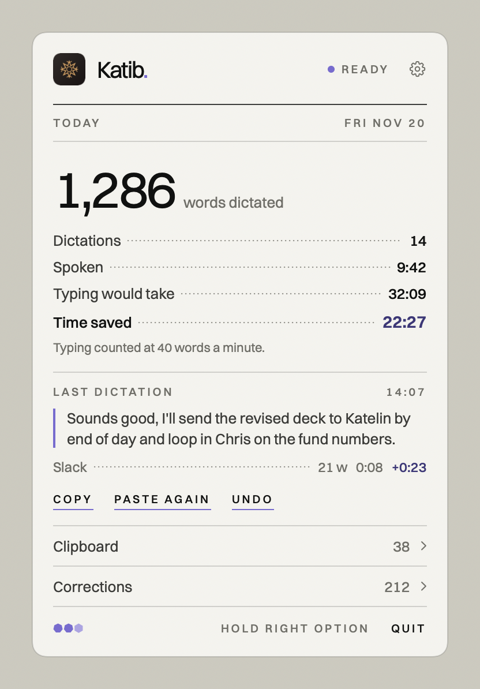
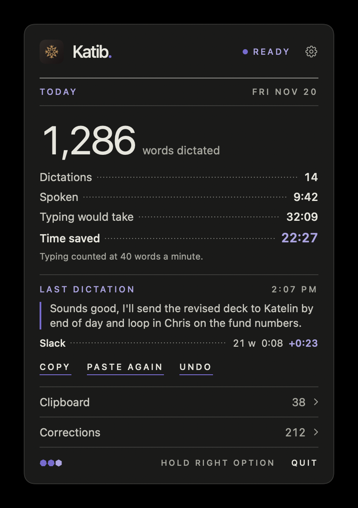
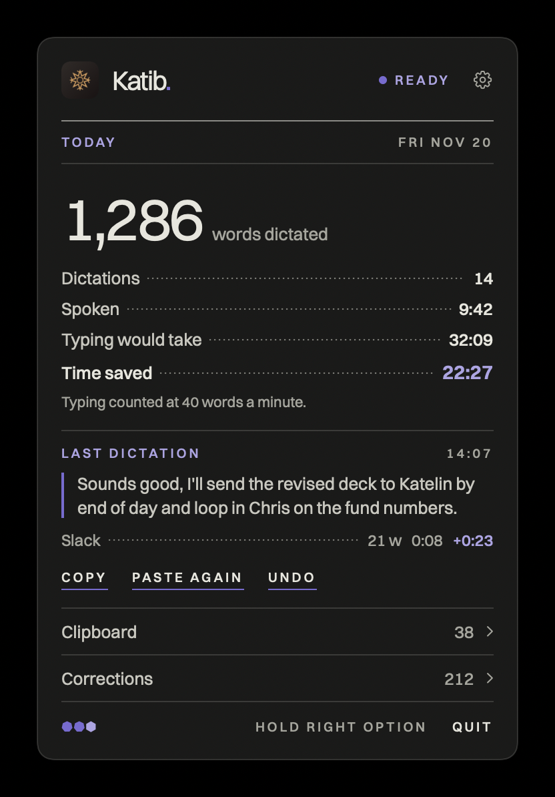

Before this change the popover had two grey capsules (14 and 1,286), the owl in the header and bronze capsule buttons. No render of it exists: the old view needs the live app, so it cannot be drawn in a test.

Before anything is dictated today, the last-dictation block shows the hint line:

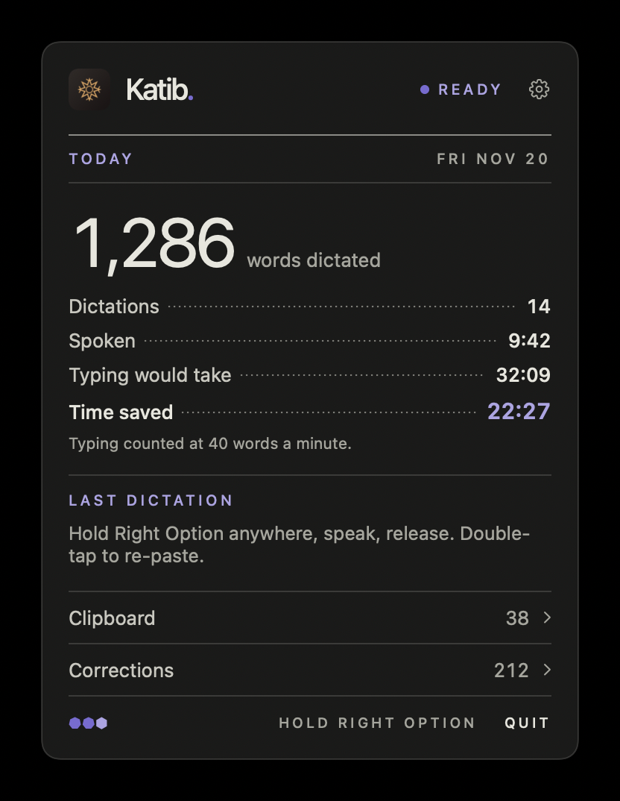
:::

:::more Receipt: built next to mockup A
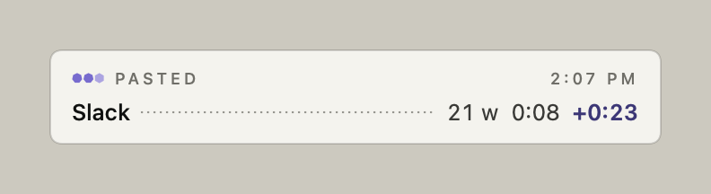
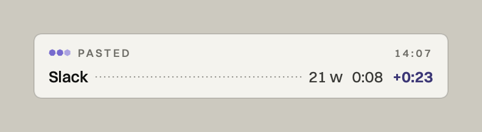
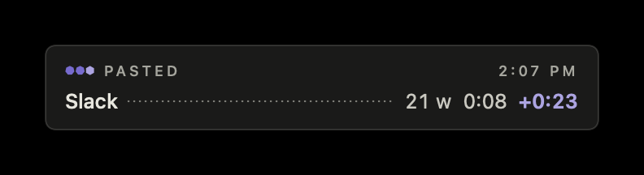
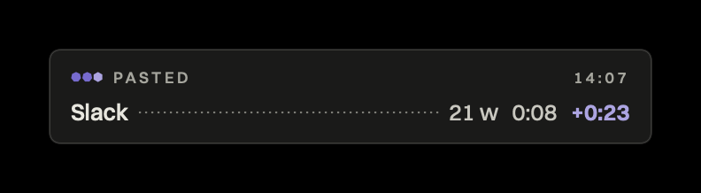
:::

:::more Time spoken, and the Switzer licence
`durationSeconds` is the time the dictation key was held: hotkey down to hotkey up (`AppDelegate.recordingStartTime`, set in `startRecording`, read in `stopRecordingAndPaste` before any processing). It is not the pipeline. It includes pauses while you hold the key, so a very hesitant dictation saves a little less than it should.

Switzer: the licence (ITF Free Font License 2.0, `experiments/visuals/theme/fonts/LICENSE.txt`) says you may "embed the Font Software in mobile or desktop applications", but section 02 also bars making the font "available to any other person" through "any ... application", and Katib goes to the 776 team as a DMG. The two clauses can be read both ways, so it is unclear and Switzer is not bundled. The type is in one place (`Type776.font` in `Theme776.swift`); a licence answer lets us switch there only.
:::
