# Katib in the 776 style, three directions
Three mockups of the popover, the Manage Permissions sheet and a dictation receipt, light and dark, all in the 776 system.
My pick is A (776 Ledger); nothing in the shipping app has changed, these are renders only.
Needed from you: pick A, B or C, and answer the Switzer licensing question below.

> [!ASK]
> **Question:** Which direction should Katib follow?
> **What happened**: Today's popover shows 14 dictations and 1,286 words as two small grey capsules, the owl sits in the header, buttons are bronze capsules. A (below) turns the same day into a ledger: 1,286 in 46pt, then Dictations 14, Spoken 9:42, Typing would take 32:09, Time saved 22:27, joined by dotted leaders. The numbers are sample data, not read from your history.
> **Proposal**: A, 776 Ledger. It is the one that reads as a 776 product at a glance (Ink and Paper, purple used once per screen, lavender labels in dark, thin rules, the three-hexagon mark in the footer) and the dotted-leader receipt is the only borrowed idea from the sifxtreme ledger. B is the same system with a gold "saved" figure, C is a centered tape.
> **Risk**: The popover is an NSPopover, so its corners and glass stay system-drawn; my mockups use a solid Paper/Ink card, so the real thing will look a little softer. C needs the most new layout work.
> **Next**: You pick. I then build the winner behind the existing views in one commit (MenuBarView, ManagePermissionsView, a small receipt panel) and check it on your Mac.

> [!ASK]
> **Question:** May Katib bundle Switzer?
> **What happened**: The 776 pages load Switzer from `theme/fonts/`, and every mockup here uses it because it is installed on this Mac. I did not bundle it and I have not read its license. A Mac app that ships the font inside Katib.app, and a DMG that goes to the 776 team, may need a different license than a website.
> **Proposal**: Check the Switzer license (Indian Type Foundry, via Fontshare) for app embedding before we bundle. Until then Katib falls back to SF Pro, which keeps the tracking and uppercase labels but loses some character.
> **Risk**: If the license forbids app embedding, we either buy a license or ship in SF Pro.
> **Next**: You or I confirm the license terms; no font file goes into the repo before that.

## The pick: A, 776 Ledger

- **Numbers become the header.** "1,286" at 46pt with tracking -.05em, then four ledger lines with dotted leaders. Time saved is the one purple figure.
- **The system, not the logo.** Small uppercase labels at .2em tracking (TODAY, LAST DICTATION, COPY), thin 1px rules, no shadows, no capsules, 6px corners on buttons, tabular digits everywhere.
- **Purple is rare.** The status dot, the left rule on the last dictation, the underline under each action, the saved figure. In dark mode labels turn lavender; the surface is Ink.
- **The icon stays.** The gold star icon is the only gold on screen. The owl leaves the popover header (it stays in the dictation HUD); the 776 mark sits in the footer, as on our pages.
- **Permissions sheet reads like a statement.** "Manage permissions." with a purple full stop, then PERMISSION / STATUS rows. Granted shows a purple dot; Grant is an outline button; the one action that finishes the job is the one filled purple button.

:::more What the receipt shows, and where the data comes from
After a paste, a small line appears for a moment: `Slack ........ 21 w  0:08  +0:23`. Words, seconds spoken and time saved against typing. `TranscriptionHistory` already stores `app`, `durationSeconds` and `wordCount` per dictation (Sources/KatibDictation/TranscriptionHistory.swift), so no new data is needed. I did not check that `durationSeconds` is the time you spoke rather than the whole pipeline.

Time saved here is words at 40 words a minute, minus seconds spoken. 21 words is 31 seconds of typing, minus 8 spoken, so 23 seconds saved. The 40 is my assumption; it should be a setting or a plain number we are happy to defend.

One thing I noticed, not verified in a running build: `todayStats()` compares the UTC date prefix, so "today" would roll over at 4 pm Pacific. A daily total in the popover makes that visible.
:::

:::more A. 776 Ledger (pick)
Popover, light and dark.

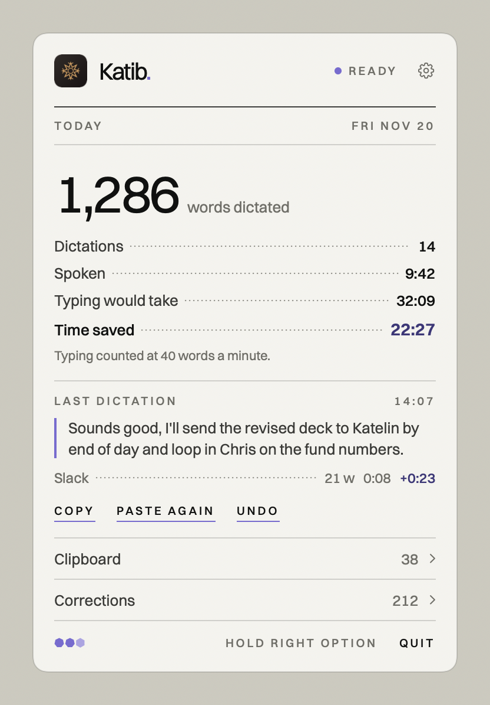
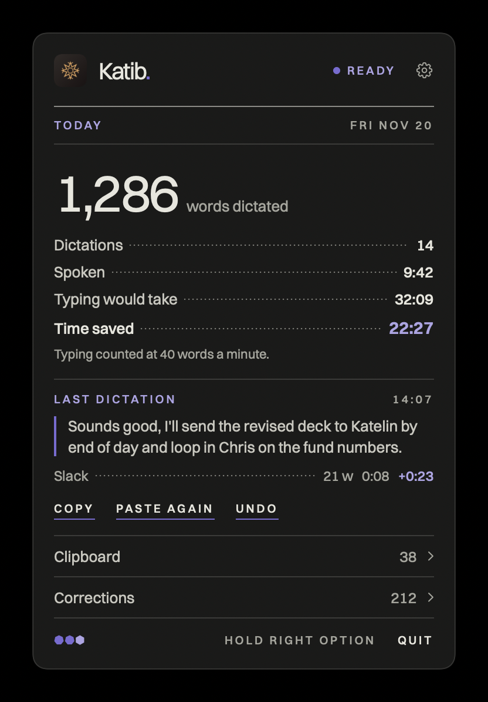

Manage Permissions, light and dark.

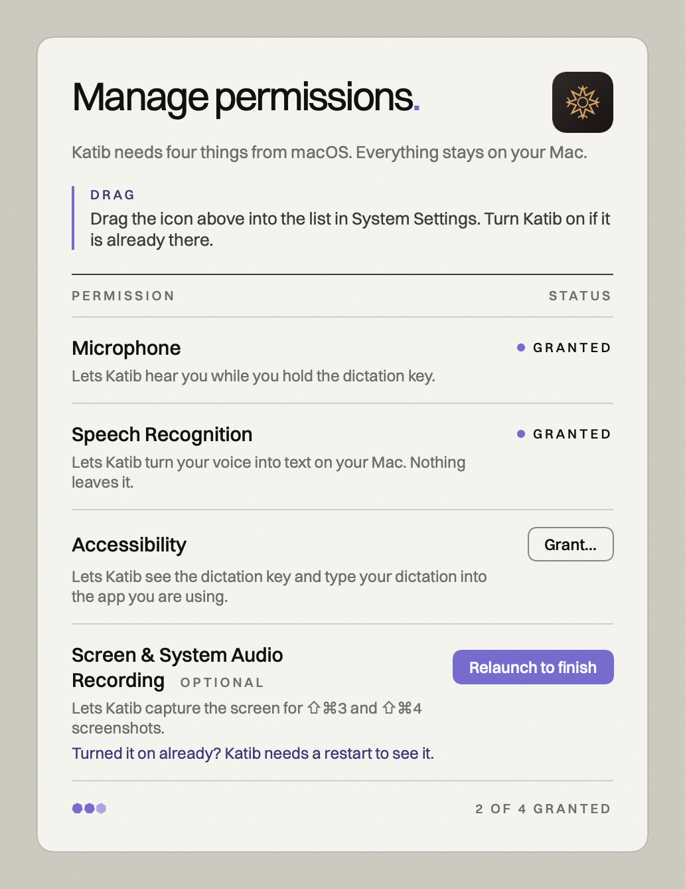
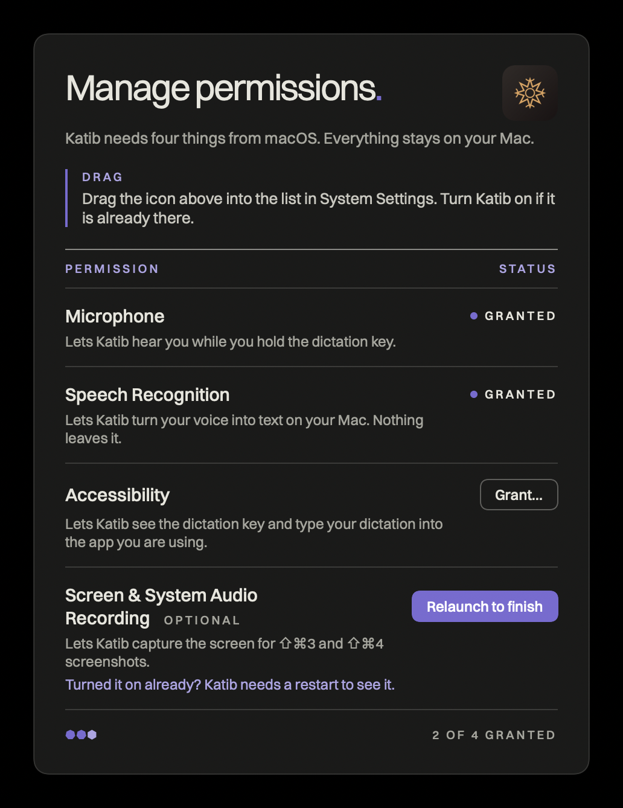

Dictation receipt, light and dark.

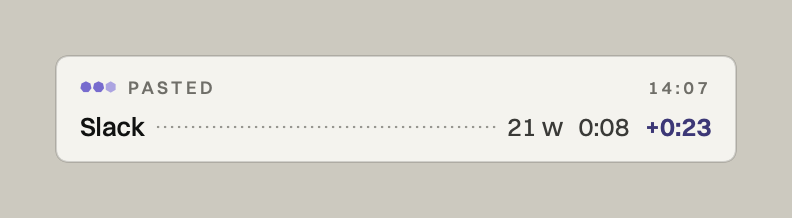
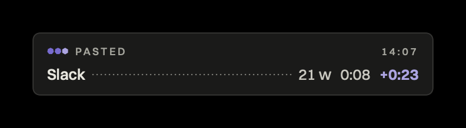
:::

:::more B. 776 Stat grid, with one touch of Katib gold
Same system, headline-led: "1,286 words today." in 32pt, a three-column stat row, outline chips for actions and a bordered permissions table. The only gold is the saved figure (the same bronze as the icon). Gold earns its place if you want "time saved" to feel like the reward; it costs the rule that purple is the only accent. On light paper the gold is darkened to keep contrast.

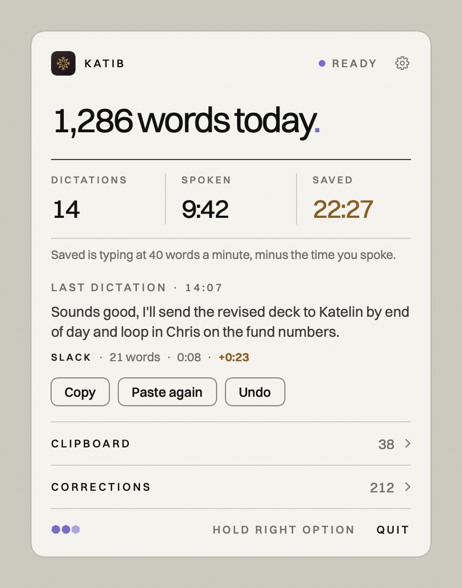
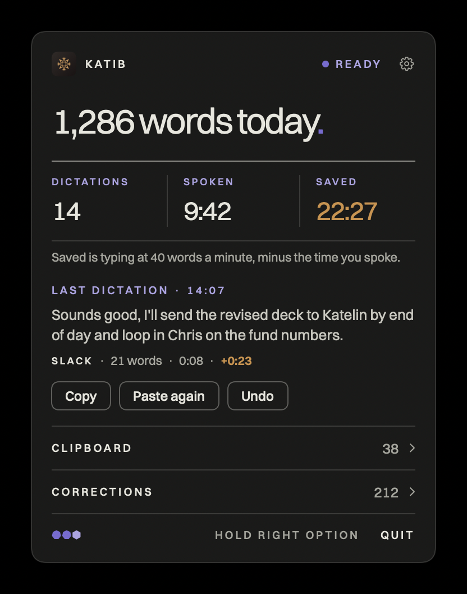
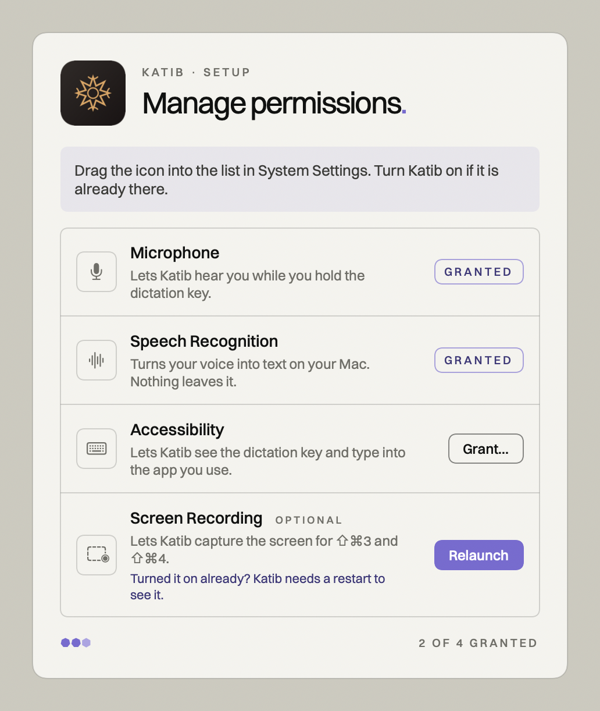
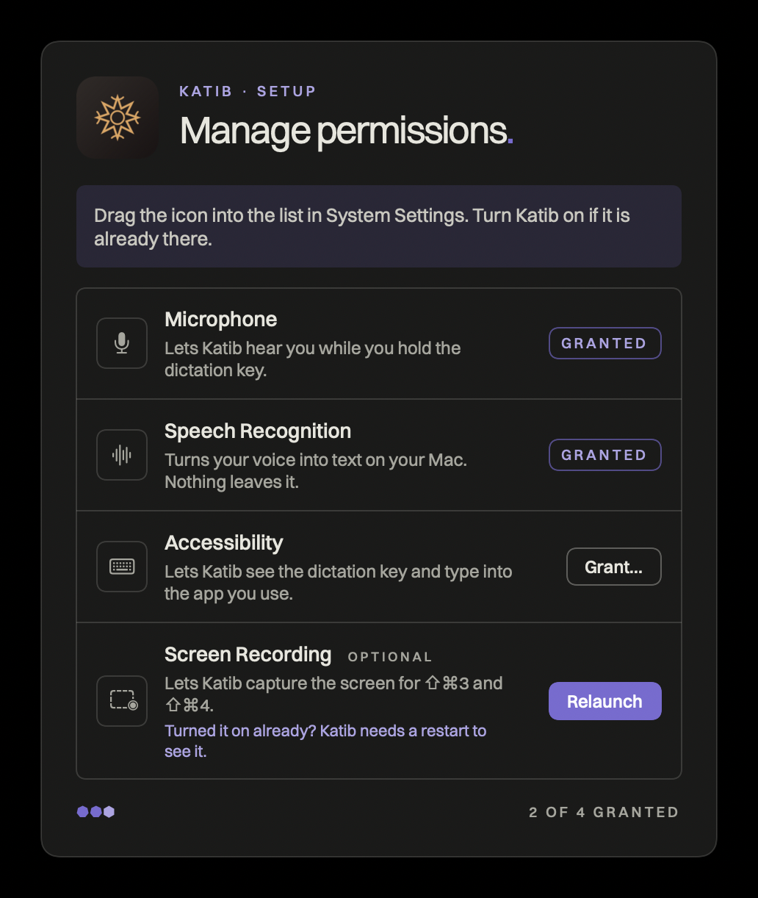
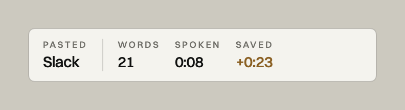
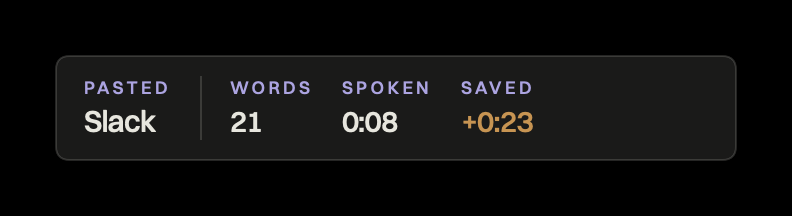
:::

:::more C. 776 Tape
Centered, like a till receipt: dashed perforations, a double rule above the total, "22:27." as the total with the purple full stop. The most distinct and the most playful. It also reads less like the other 776 pages and needs the most new layout, so it is third.

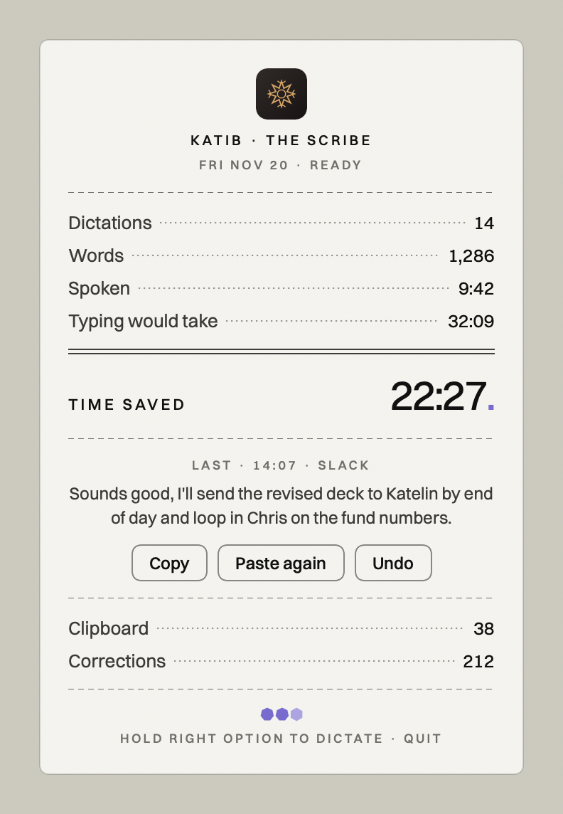
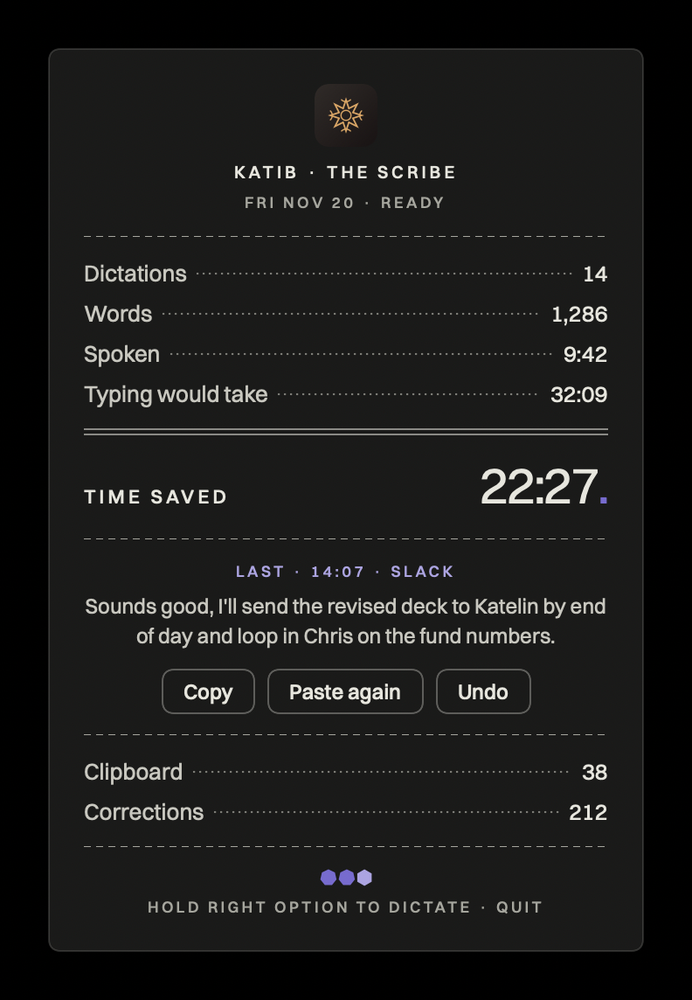
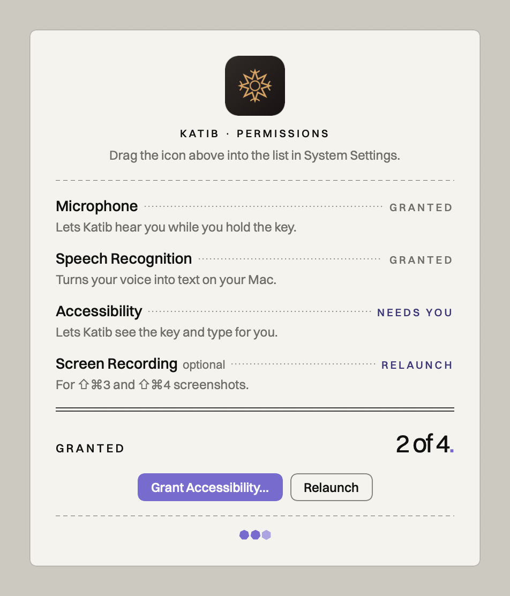
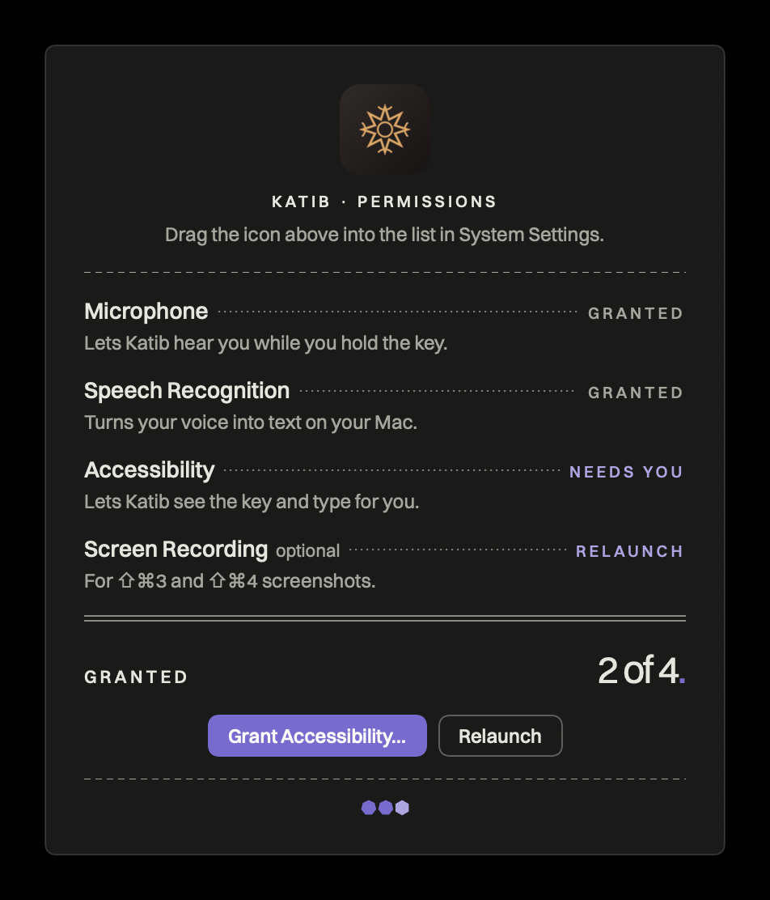
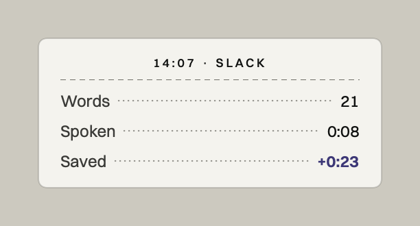
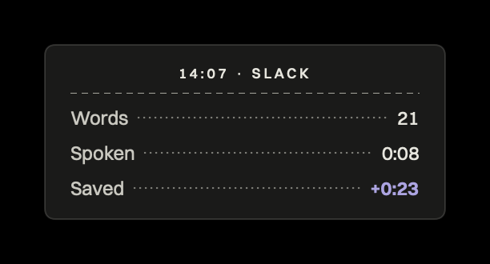
:::

:::more How these were made
A throwaway SwiftUI renderer in `harness/` (its own package, not part of Katib). Run: `KATIB_ICON=<repo>/AppIcon.icns swift run mock <out dir>`. Colors come from `experiments/visuals/theme/776.json`; the mark from `page/assets/776-mark.svg`. Sample numbers are made up: 14 dictations, 1,286 words, 9:42 spoken.
:::
